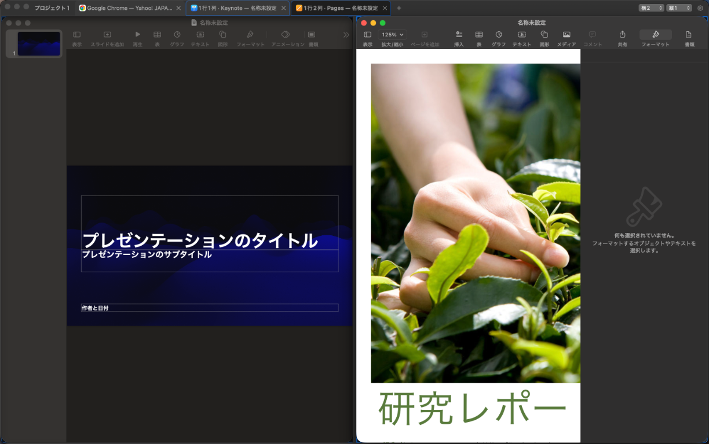

# WindowDock

Group windows from different Mac apps into a workspace for each task. Switch between them with tabs, or split the workspace into panes to see windows side by side. Move or resize the workspace and its windows follow.



## Getting started

WindowDock requires macOS 13 or later.

**Install the release:** Download the DMG from [Releases](https://github.com/kamo-naoyuki/WindowDock/releases), drag WindowDock to Applications, and open it. If macOS blocks the first launch, go to **System Settings → Privacy & Security** and choose **Open Anyway**.

**Build from source:** With Xcode Command Line Tools (Swift 5.10 or later) installed, run:

```sh
git clone https://github.com/kamo-naoyuki/WindowDock.git
cd WindowDock
bash build-app.sh
open dist/WindowDock.app
```

On first launch, allow WindowDock to move and resize windows in **System Settings → Privacy & Security → Accessibility**. Screen Recording permission is not required. Click **+** in the tab bar to choose windows, or drag a window onto the tab bar.

## Using a workspace

- Click a tab to switch windows. Use **Control+Tab** for the next tab or **Control+Shift+Tab** for the previous one.
- Right-click a displayed tab and choose **Pane → Split Left and Right / Split Top and Bottom** to split just that pane. Repeat to nest up to four subdivisions in each direction (4×4 equivalent); unavailable directions are disabled, including known app minimum-size limits. The same actions are available on an empty pane or under **Workspace → Pane**. Drag each divider to resize; **Close Pane** keeps its windows as tabs. The column/row controls return to a regular grid; custom layouts and divider positions are saved.
- Select **Automatically Hide Tab Bar** from the Workspace menu or the workspace name menu to reclaim vertical space; move the pointer to the top edge to reveal it. Control+Tab briefly reveals the bar too.
- Press **⌘N** to create another workspace. Drag tabs to reorder them or move them between workspaces; a workspace comes to the front when you drag a tab over it.
- Press **⌘W** to remove the selected window from the workspace without closing it.
- If you maximize, move, or resize a window outside WindowDock, or make it full screen, switching back to WindowDock fits it into its pane again.

Use windows from the current Space. Windows that are already full screen and windows that can't be moved or resized aren't supported.

[MIT License](LICENSE)
